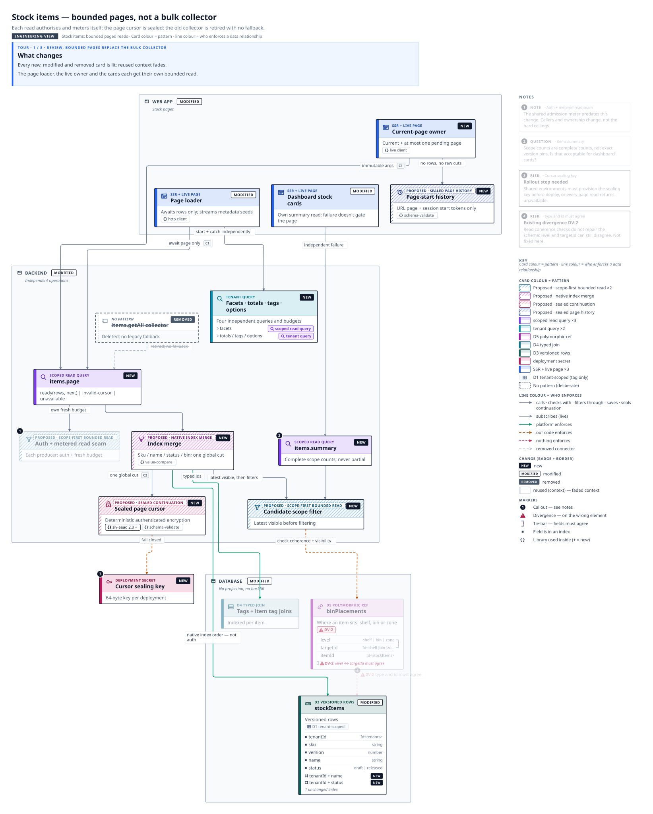
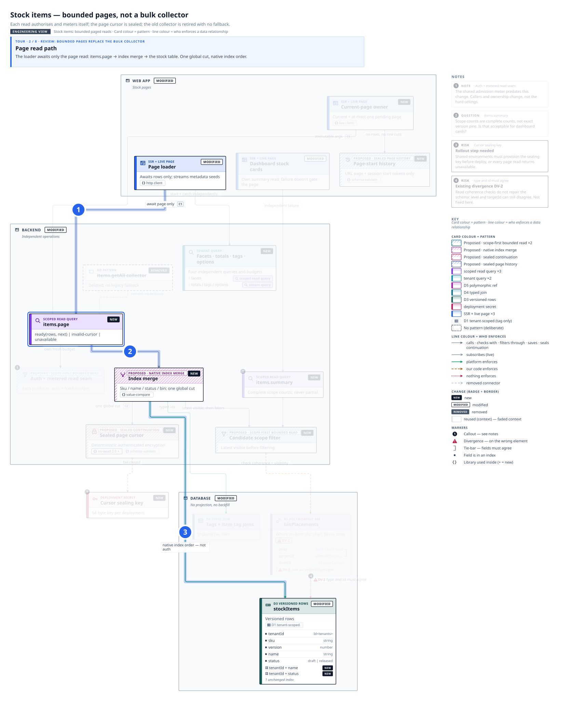
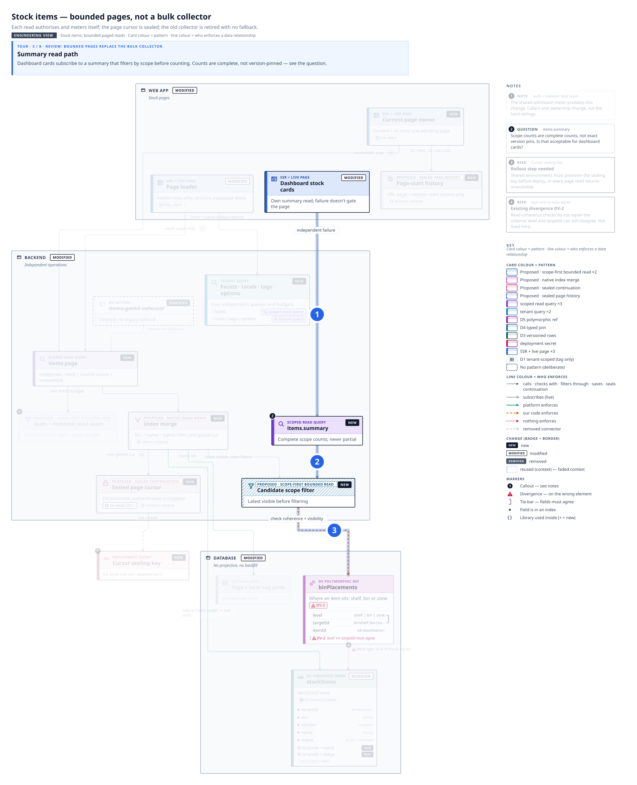
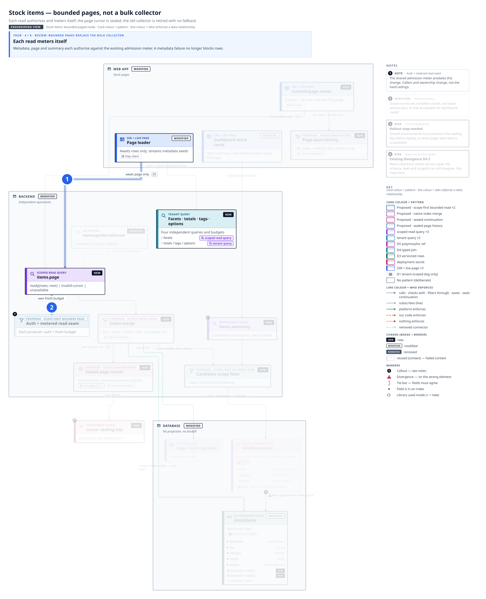
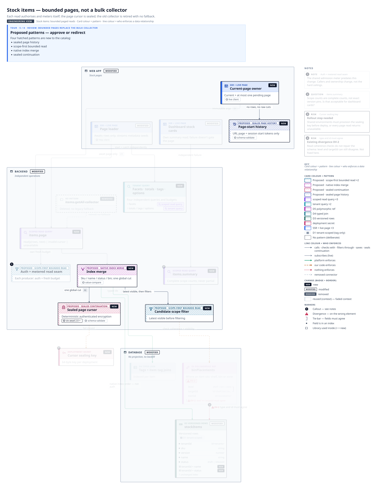
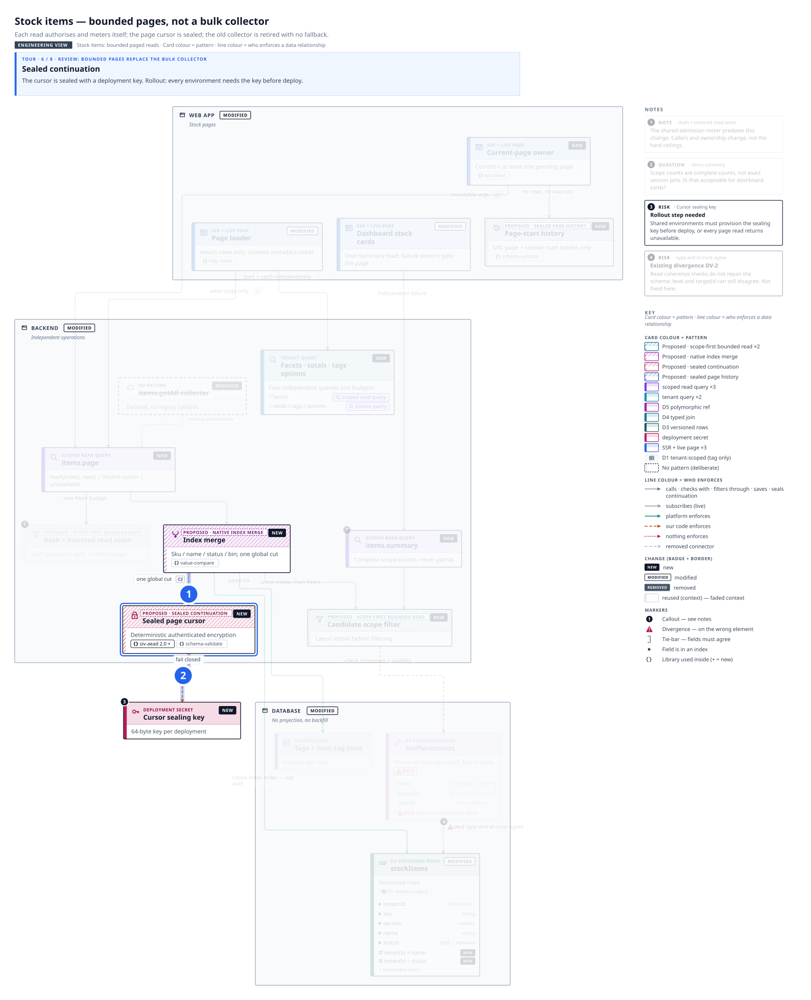
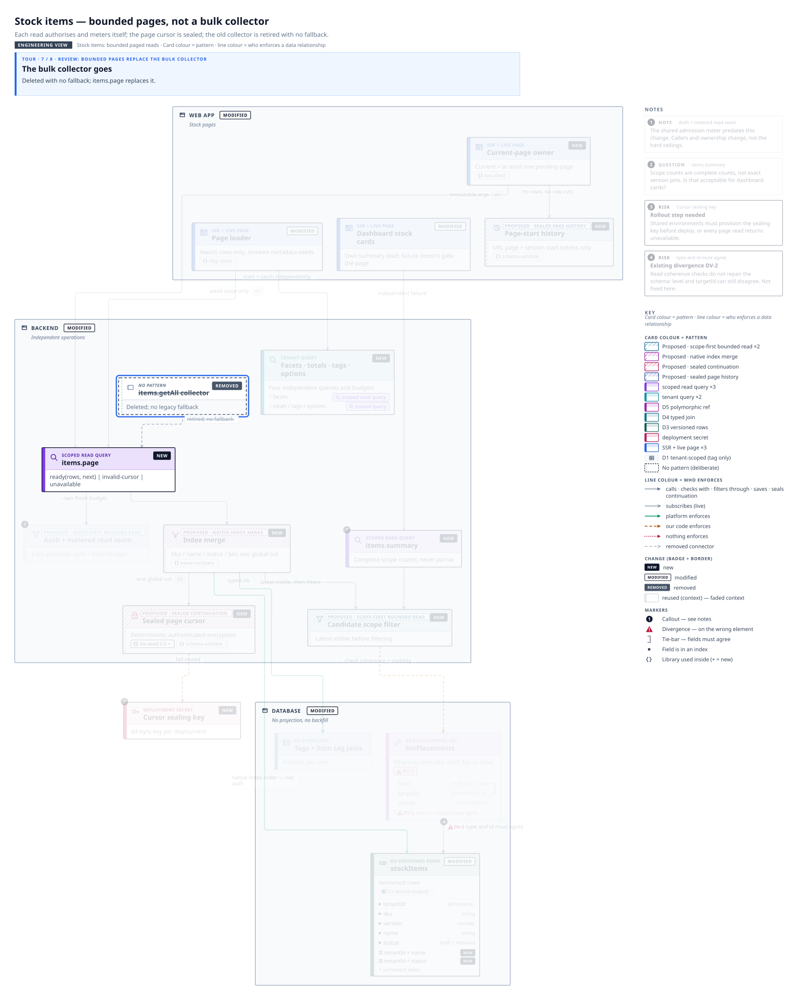
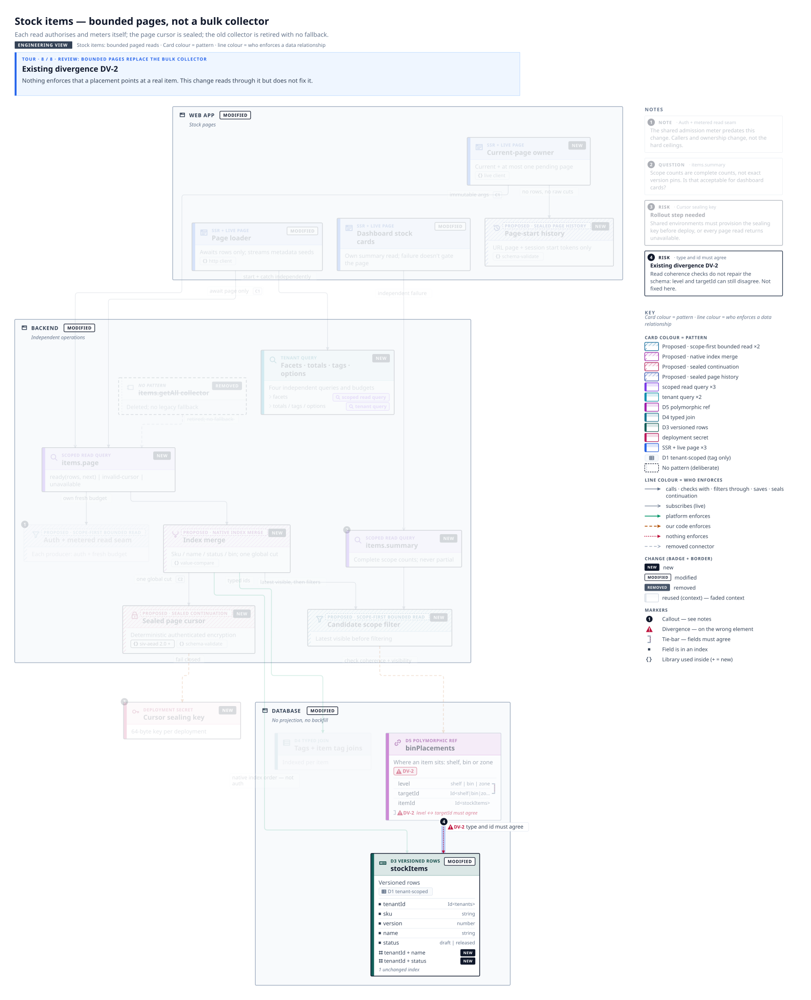

# Review: bounded pages replace the bulk collector

What changes, the two read paths, the proposed patterns, then the risks.

## 1. What changes

*View: Stock items — bounded pages, not a bulk collector* · viewer link: `#tour=review&step=what-changes`

Every new, modified and removed card is lit; reused context fades.

The page loader, the live owner and the cards each get their **own** bounded read.

## 2. Page read path

*View: Stock items — bounded pages, not a bulk collector* · viewer link: `#tour=review&step=page-read`

The loader awaits only the page read: `items.page` → index merge → the stock table. One global cut, native index order.

## 3. Summary read path

*View: Stock items — bounded pages, not a bulk collector* · viewer link: `#tour=review&step=summary-read`

Dashboard cards subscribe to a summary that filters by scope before counting. Counts are complete, not version-pinned — see the question.

## 4. Each read meters itself

*View: Stock items — bounded pages, not a bulk collector* · viewer link: `#tour=review&step=budgets`

Metadata, page and summary each authorise against the existing admission meter. A metadata failure no longer blocks rows.

## 5. Proposed patterns — approve or redirect

*View: Stock items — bounded pages, not a bulk collector* · viewer link: `#tour=review&step=proposed`

Four hatched patterns are new to the catalog:
- sealed page history
- scope-first bounded read
- native index merge
- sealed continuation

## 6. Sealed continuation

*View: Stock items — bounded pages, not a bulk collector* · viewer link: `#tour=review&step=sealing`

The cursor is sealed with a deployment key. **Rollout:** every environment needs the key before deploy.

## 7. The bulk collector goes

*View: Stock items — bounded pages, not a bulk collector* · viewer link: `#tour=review&step=removed`

Deleted with no fallback; `items.page` replaces it.

## 8. Existing divergence DV-2

*View: Stock items — bounded pages, not a bulk collector* · viewer link: `#tour=review&step=divergence`

Nothing enforces that a placement points at a real item. This change reads through it but does not fix it.

