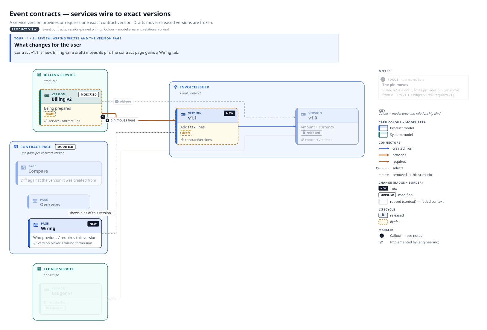
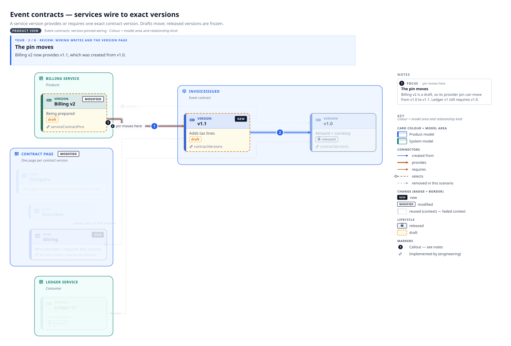
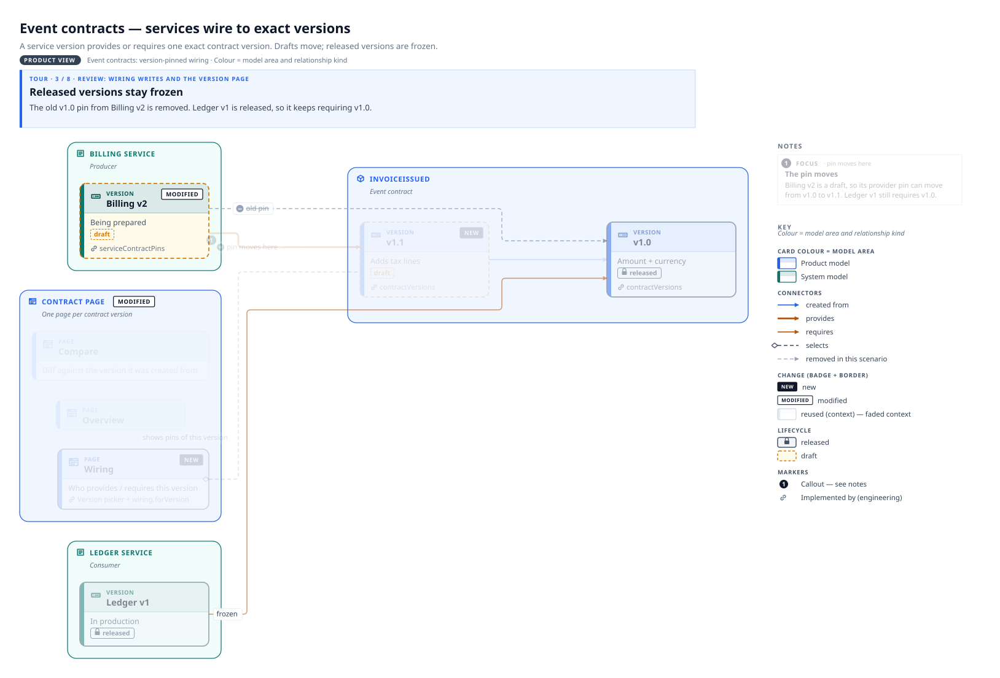
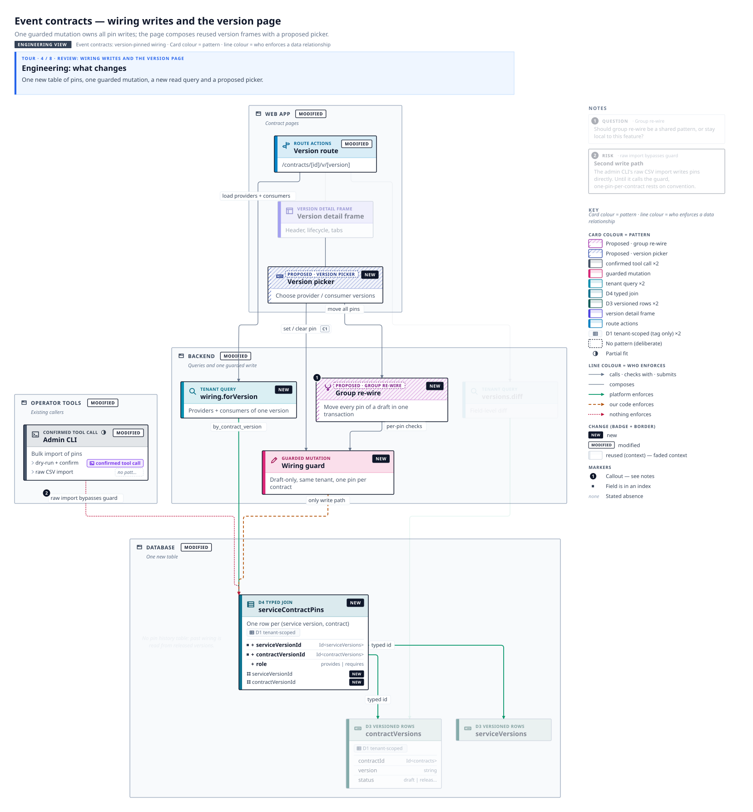
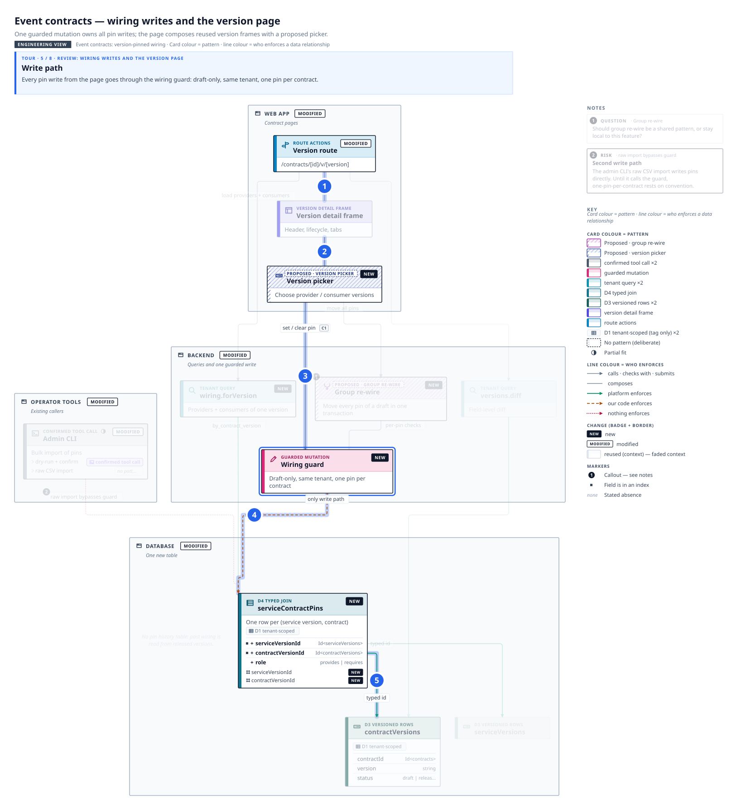
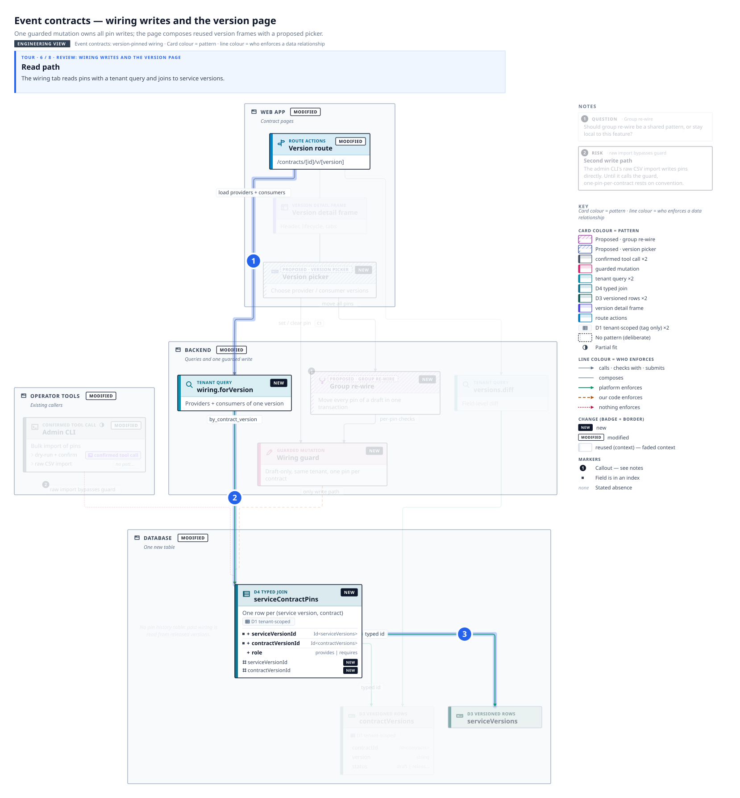
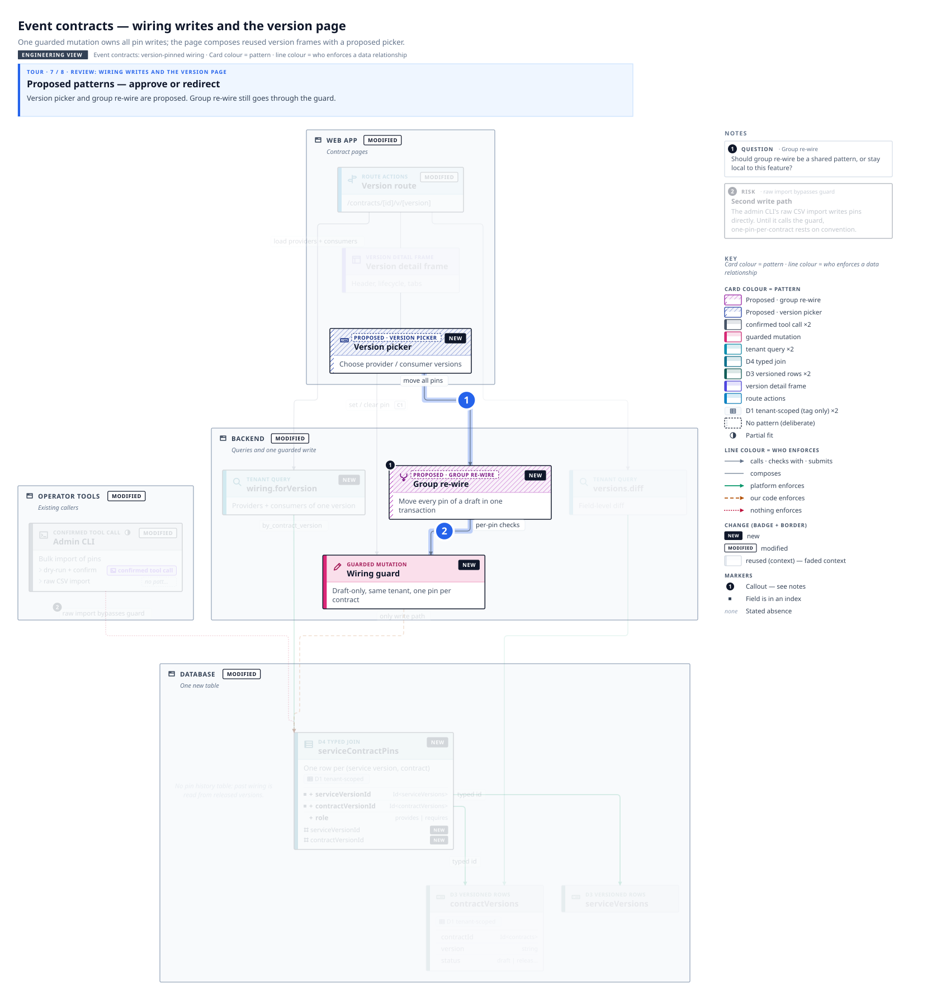
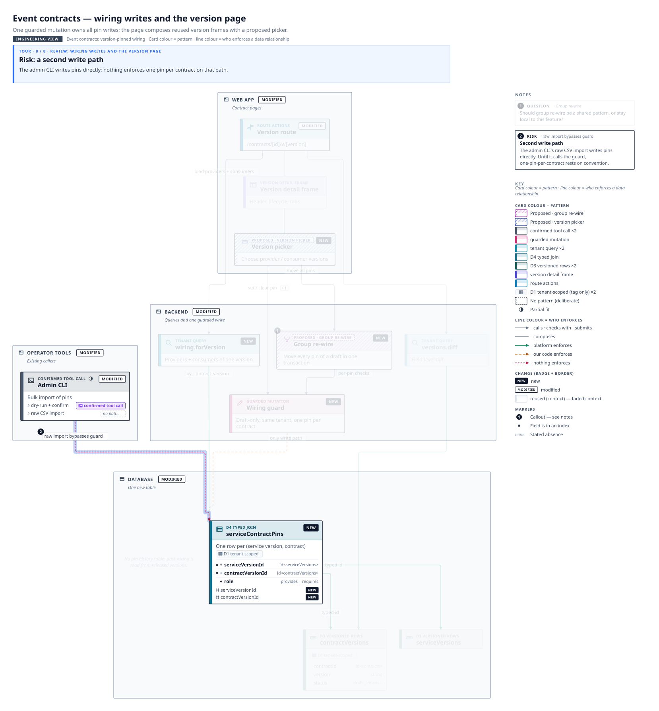

# Review: wiring writes and the version page

The product change first, then the write and read paths, the proposals and the open risk.

## 1. What changes for the user

*View: Event contracts — services wire to exact versions* · viewer link: `#tour=review&step=product-change`

Contract **v1.1** is new; Billing v2 (a draft) moves its pin; the contract page gains a **Wiring** tab.

## 2. The pin moves

*View: Event contracts — services wire to exact versions* · viewer link: `#tour=review&step=pin-moves`

Billing v2 now provides v1.1, which was created from v1.0.

## 3. Released versions stay frozen

*View: Event contracts — services wire to exact versions* · viewer link: `#tour=review&step=frozen`

The old v1.0 pin from Billing v2 is removed. Ledger v1 is released, so it keeps requiring v1.0.

## 4. Engineering: what changes

*View: Event contracts — wiring writes and the version page* · viewer link: `#tour=review&step=eng-change`

One new table of pins, one guarded mutation, a new read query and a proposed picker.

## 5. Write path

*View: Event contracts — wiring writes and the version page* · viewer link: `#tour=review&step=write-path`

Every pin write from the page goes through the **wiring guard**: draft-only, same tenant, one pin per contract.

## 6. Read path

*View: Event contracts — wiring writes and the version page* · viewer link: `#tour=review&step=read-path`

The wiring tab reads pins with a tenant query and joins to service versions.

## 7. Proposed patterns — approve or redirect

*View: Event contracts — wiring writes and the version page* · viewer link: `#tour=review&step=proposed`

**Version picker** and **group re-wire** are proposed. Group re-wire still goes through the guard.

## 8. Risk: a second write path

*View: Event contracts — wiring writes and the version page* · viewer link: `#tour=review&step=risk`

The admin CLI writes pins directly; nothing enforces one pin per contract on that path.

